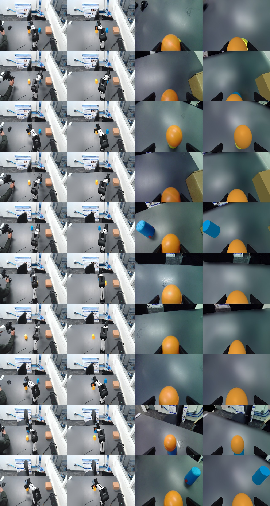

# Simulated teleop station

A MuJoCo replica of the real YAM setup that recorded `data/ball_pick_and_place`: the follower arm
with its linear gripper and wrist camera, the table, the two cups, the ball, the cardboard box and
both cameras. Everything that could be measured from the recordings was measured from them rather
than modelled by hand — camera models, object sizes and positions, joint friction, paints, camera
latency, even the pictures on the walls.

It speaks the dataset's format. Observations are `observation.state` (six joint angles and the
gripper opening) plus `observation.images.overhead` and `observation.images.right_wrist`
(480x640 RGB); actions are seven joint/gripper targets. A policy trained on the real recordings
runs here unchanged, and simulated episodes are written in the real recorder's folder layout.



*Each row: overhead real, overhead simulated, wrist real, wrist simulated — the scene posed at a
recorded frame.*

## Quick start

Use the repo's virtualenv (`source .venv/bin/activate`); run everything from the repo root.
Beyond the package's own dependencies it needs OpenCV (as the teleop recorder does), SciPy for the
calibration scripts and PyAV to write videos — all present once LeRobot is installed; otherwise
`uv pip install opencv-python-headless scipy av`. On a headless Linux machine (a training server) set
`MUJOCO_GL=egl` so the cameras can render without a display.

```bash
# How close is it? Replays every recorded episode and compares images.
python -m i2rt.simulation.evaluate                                  # -> outputs/evaluation.json, real_vs_sim.jpg

# Side-by-side video (real | simulated, both cameras) of one episode replayed through the physics
python -m i2rt.simulation.replay --episode episode_0020             # -> outputs/episode_0020_physics.mp4
python -m i2rt.simulation.replay --episode episode_0020 --mode kinematic    # cameras only, no physics

# Look around interactively (macOS needs mjpython; on Linux plain python)
.venv/bin/mjpython -m i2rt.simulation.view --episode episode_0020

# Run a trained LeRobot policy (ACT, pi0.5, ...) in the simulation; --jitter 0.02 moves the cups around.
# (Checked end to end with an untrained ACT checkpoint in lerobot-train's layout, not yet with a trained policy.)
python -m i2rt.simulation.run_policy --policy-path outputs/train/yam_act/checkpoints/last/pretrained_model

# Write simulated copies of the recorded episodes in the recorder's format (convert_to_lerobot reads them)
python -m i2rt.simulation.record --out data/ball_pick_and_place_sim
```

From Python:

```python
import numpy as np
from i2rt.simulation import episodes
from i2rt.simulation.env import YamStationEnv

env = YamStationEnv()
name, state, setup = episodes.sample_start(np.random.default_rng(0))   # how a recorded episode began
obs = env.reset(state, objects=setup.objects)
for _ in range(300):
    action = obs["observation.state"]            # your policy here: 6 joint targets + gripper in [0, 1]
    obs = env.step(action)                       # 1/30 s of physics, then both cameras
obs["observation.images.overhead"], obs["observation.images.right_wrist"]   # 480x640x3 uint8 RGB
```

`episodes.sample_start` needs only this folder (the recorded starts are stored in
`calibration/results/episode_starts.json`), so policies can be rolled out on a machine that does not
have the raw recordings. `replay`, `evaluate`, `record` and the calibration scripts read the recordings.

## How close it is

`python -m i2rt.simulation.evaluate`, over all 39 recorded episodes, with the calibration in this folder:

| Measurement | Result |
| --- | --- |
| **Open-loop replay.** Each episode's recorded actions are run through the simulated arm and physics from the real starting conditions. Does the ball end up on the cup the operator put it on? | **36 of 39 episodes** |
| Joint tracking during those replays (simulated minus real joint angle, RMS) | 0.13°, 0.38°, 0.30°, 0.42°, 0.30°, 0.28° for joints 1–6; gripper 0.8 % of its stroke |
| Overhead camera, simulated vs real frame (operator's end of the table excluded) | mean abs. error 7.0 / 255, SSIM 0.88 |
| Wrist camera, simulated vs real frame | mean abs. error 15.7 / 255, SSIM 0.84 |
| Overhead camera calibration residual (the arm's outline, simulated vs real) | 2.0 px |
| Wrist camera calibration residual (fingertip, cup and ball outlines, on frames it was not fitted to) | 2.7 px |

Nothing but the recorded *actions* goes into a replay, so the ball only lands on the cup if the
cameras' geometry, the object sizes, the arm's dynamics and the contact model are all right together.
Caveats, so the numbers are read for what they are: the objects' starting positions and the fitted
parameters come from these same episodes (the joint dynamics were fitted on every third one); some
episodes are marginal — replay success moved between 35 and 38 of 39 while details were being
refined, and it still moves when the calibration is simply run again (see below); and the image
scores compare each frame against a room textured partly from that same episode (on frames held out
of the texturing, the wrist camera's background error is about a third lower with an episode's own
textures than with the shared ones, not more). The arm's dynamics are fitted on, and checked
against, motion like the demonstrations': joint speeds up to about 1 rad/s and targets within
0.17 rad of where the arm is. The simulated motors have the real torque limits (28 and 10 N·m) but
no top speed, so motion much faster than that is plausible physics, not a measured match. Under
random commands the simulation stays stable; it has not been compared with the real arm there.

The same overhead calibration also fits the other recorded session (`data/yam_teleop`, 3.1 px), so
that camera did not move between them. Both camera calibrations reproduce when re-run from scratch:
the overhead camera to within 2 mm and 1.5 px, the wrist camera to the same residual.

Run again from the state it left, the calibration does not return exactly the same answer. The
overhead camera does, to the last digit. But four cups the arm hides from the overhead camera are
located through the wrist camera, whose own fit uses the cups, so each run starts from the previous
one's answer — and the wrist camera's tilt trades against its principal point at no cost in
residual. Between the last two full runs the wrist camera moved by 1.3 mm and 0.7° (2.7 px on
held-out frames both times), five cup positions by 2–4 mm, the wrist latency from 70 to 54 ms, and
the replay count from 37 to 36: `episode_0035`, one of those four cups, is the one that flipped.
The shipped calibration is the last run's; its wrist camera's principal point sits within a pixel
of the image centre.

## What is in the scene and where each number came from

| Part | How it was obtained |
| --- | --- |
| Arm and gripper | The repo's own YAM + `linear_4310` model. Repainted like the real arm (white shells, black motor housings) by cutting the two-tone links where the meshes' own flat faces put the seams. Wrist-camera mount and the cable along the arm added (`robot_visuals.py`). |
| Overhead camera | `calibration/overhead_camera.py`. The arm is the calibration target: its joint angles are logged with every frame, so the camera pose is the one that makes the rendered arm outline match the real one over 100 still frames. Focal length from the room's vanishing points (`room_lines.py`): fy = 508 px — a 16:9 sensor with an 88° diagonal view squashed to 640x480, as the camera's data sheet says. No measurable lens distortion. |
| Wrist camera | `calibration/wrist_camera.py`. Same idea with the fingertips (pose on the gripper), the cups and the ball (focal length). It sits 7 cm above the gripper axis looking 23° down, within a centimetre of I2RT's own wrist-camera mount design. |
| Cups, box | `calibration/objects.py`. Sizes from their outlines in the overhead view — cups 73 mm rim, 53 mm base, 77 mm tall; box 128 x 131 x 69 mm — and their position in every episode. Of the 78 cup positions, 61 come from the overhead camera, 4 from the wrist camera (cups the arm hides from above), 13 from where the gripper picked up or set down the ball. |
| Ball | Soft, 60 mm (see below). |
| Table, walls, floor | Photographs. The overhead camera's static view and the wrist camera's footage are re-projected onto the table plane and onto flat stand-ins for the floor and two walls, with arm, cups and operator removed (`bake_overhead.py`, `bake_wrist.py`). Removed, not averaged away: the simulation knows where the arm and the objects were in every frame, so each table pixel is the median of the frames in which nothing covered it. In the overhead view that keeps the table's own marks right up to the arm; only the patch under the arm's base and the box, which the camera never sees, is filled in smoothly. The wrist camera's table also gets its measured gloss: a highlight that moves with the camera (`sheen.py`). |
| Joint dynamics | `calibration/dynamics.py`. The real motor gains (kp/kd from `yam_v1.yml`) with joint friction, damping, rotor inertia and an effective gravity-compensation factor fitted so the simulated arm follows the recorded commands as the real one did. Dry friction came out at 0.7–1.9 N·m on the three big joints: it is what lets the real arm rest up to 0.015 rad off its targets. Commands are clipped to the joint limits plus 0.15 rad and torques to the motors' 28 / 10 N·m, as the real controller and motors do. |
| Paints | `calibration/appearance.py`. Per material and per camera, scaled until simulated and real pixels of the same surface agree. |
| Light | `calibration/lighting.py`. Where the room's light comes from, fitted to the shadows the arm and the cups cast on the table: it leans 16° from overhead, so shadows fall towards the camera and to the right, as in the footage. |
| Camera pipeline | `rendering.py`, values in `calibration/results/image_models.json`: soft shadows, the webcam's sharpening, sensor noise, JPEG, and for the wrist camera auto-exposure and flicker. |
| Camera latency | `calibration/latency.py`. Frames are older than the joint reading saved with them — about 80 ms for the overhead camera and 55 ms for the wrist camera (the wrist fit's minimum is broad: 50–80 ms score within a few percent of each other) — measured from frames taken while the arm moved fast. The environment hands out frames that stale. |

`python -m i2rt.simulation.calibration.run_all` redoes all of it from a dataset (about 45 minutes on
this laptop; `--steps` runs a subset). The calibration in this folder is that command's output, start
to finish. The only numbers set by hand are the table plane (see below) and the cameras' noise,
sharpening and exposure constants in `image_models.json`, measured once with throwaway scripts.
Each script's docstring says what it measures and how.

## Things worth knowing

**The table is not at z = 0.** The world frame is the arm's base frame and the base stands on the
table, so the table top ought to be the plane z = 0. Seen through the arm's kinematics it is not.
Three independent measurements put it higher in the workspace: the wrist camera's close-up views
of the ball on a cup (about +25 mm), where the ball sits between the fingers at the recorded grasps
(about +40 mm), and replay success, which is 7 of 39 with the table at 0, 33 at +15 mm, 36 at +30 mm
and 33 at +45 mm. A forward tilt of the arm, the obvious explanation, does not fit the wrist
camera's views. The cause is most likely joint zero offsets together with the mount giving under
load; the recordings cannot tell those apart. The simulation keeps the arm model as it is and puts
the table where the arm sees it: +30 mm (`table.py`, `calibration/results/table_plane.json`), with
gravity normal to it. If the arm is re-zeroed or re-mounted, re-check this:
`wrist_camera.py --fit-plane` and `grasp_events.py` both estimate it.

**The ball is soft; rigid-body contact is not.** The real ball is a hollow shell that the gripper
squeezes to as little as half its width, and it stays put when pinched at the fingertips, where a
rigid sphere would pop out. So the fingertips' contacts with the ball are soft (with the ball only:
the same fingers stop dead on the table, the cups and the box), and while both fingers press into
the ball it is tied to the gripper where it sits and released the moment the fingers open wider than
the ball (`EnvConfig.soft_ball_grasp`, on by default; the ball is also drawn squeezed). With that
off, rigid contact alone still replays 35 of 39 episodes.

**Each camera has its own backdrop and its own paints.** A photographed surface only lines up from
the viewpoint it was photographed from, and the two cameras disagree about colour (the cup the
overhead camera sees as orange is yellow to the wrist camera). The renderer switches both per camera.
The overhead backdrop is a flat sheet behind the scene; the wrist camera's is real 3D geometry (table,
floor, two walls). Chairs and people moved between episodes, so both keep one picture of the room
per recorded episode besides the usual one: `env.set_backdrop(name)` shows an episode's own.

**Observations are as stale as the real ones.** `env.step` pairs each joint state with camera frames
rendered about 80 ms / 55 ms earlier, because that is what the recordings pair them with. Turn it off with
`EnvConfig(camera_latency=False)`.

**Domain randomisation.** `env.randomize_appearance(rng)` jitters both cameras' poses, the paints
and the exposure by about the size of the calibration's own residuals; `episodes.sample_start(rng,
jitter=0.02)` moves the cups. `EnvConfig(supersample=1)` trades anti-aliasing for speed (physics alone
runs ~45x real time; with both cameras a step takes ~70 ms, ~50 ms at `supersample=1`).

**What is not simulated.** The operator and the leader arm at the left end of the table (painted
out). The power brick, its cables and the zip tie on the table are pictures, not objects. The cable
tie's long tail on the forearm is missing. The table's scuff marks survive in the overhead view but
are averaged away in the wrist view. Chairs and people beyond the table are flat pictures, sharp
only from where they were photographed. The ball's softness is a contact model, not a deformable body.

## Files

```
scene.py            builds the MuJoCo model (arm, table, objects, cameras, lights)
env.py              YamStationEnv: reset / step / observe in the dataset's format, with the real control law
rendering.py        the two cameras as the real ones record: lens, shadows, sheen, colour, noise, 640x480
cameras.py          pinhole + distortion camera model shared by calibration and rendering
table.py            the table plane in the arm's frame
robot_visuals.py    paint, wrist-camera mount, cable, finger colliders
episodes.py         recorded episodes as simulation set-ups (where everything was at the start)
replay.py           replay an episode (physics or kinematic) and write a side-by-side video
evaluate.py         the measurements in the table above
record.py           write simulated episodes in the recorder's format
run_policy.py       run a LeRobot policy in the simulation
view.py             interactive viewer
export.py           write a standalone MJCF folder (python -m mujoco.viewer --mjcf=.../scene.xml)
calibration/        the scripts that measured everything; results/ holds what they measured
assets/             photographed textures, the sheets they sit on, per-episode backdrops, the sheen map (11 MB)
tests/              pytest suite (physics and geometry run anywhere; rendering needs OpenGL;
                    the replay test needs the recordings and is skipped without them)
```
